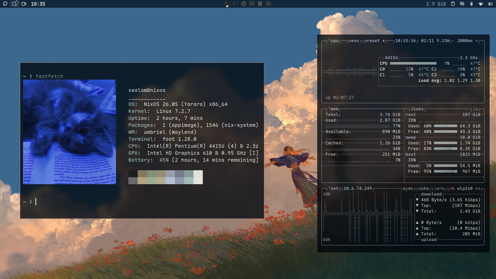

<div align="center">

# dotfiles

**My NixOS setup — Umbriel + Noctalia, with a small installer.**


[](https://codeberg.org/dnkl/foot)



</div>

> Looking for just the app configs? See the [`configs` branch](https://github.com/Malte-Dzierzon/dotfiles/tree/configs) for plain `~/.config` files without the NixOS configuration.

## Desktop setup

NixOS 26.05 · Umbriel · Noctalia · foot / Kitty · fish/zsh + Starship · Zed/Neovim · Zen · Yazi · Walker.

<details>
<summary><b>The dot command</b></summary>

The `dot` command provides shortcuts for applying, checking, and managing the configuration.

```bash
dot          # interactive menu (check/apply/apps/restore)
dot app-list # installed TUI/GUI apps with bundle column
dot apps     # toggle optional apps for this machine (saves, no activation)
dot check    # read-only validation (--full adds flake eval + dry build)
dot apply    # link configs, build, confirm, switch, verify
dot restore  # generation rollback info (system only, not source files)
dot help     # command reference
```

Helpers kept outside the core: `default-app` (role launcher), `mime`
(`--fix` aligns MIME with roles), `applist`, `mode` (desktop/headless),
`verify`. Git is yours: normal `git` commands, no `dot sync/save` wrapper.

</details>

<details>
<summary><b>Configuration</b></summary>

### Desktop settings

The Umbriel configuration is in `dotfiles/.config/umbriel/`. The main `config.toml` loads the individual files in order.

| File | Settings |
|---|---|
| `bindings.toml` | Keybindings |
| `input.toml` | Keyboard repeat, touchpad, and cursor theme |
| `look.toml` | Gaps, borders, blur, and shadows |
| `monitors.toml` | Display modes for each output |
| `autostart.toml` | Applications started at login |
| `env.toml` | Environment variables and hot corners |

### Default applications

Application roles are defined in `config/defaults.toml`. Keybindings use `default-app <role>`, so changing a role updates the applications used by the corresponding shortcuts.

Terminal-based editors such as Neovim are opened in the configured terminal automatically.

| Role | Default | Example |
|---|---|---|
| `terminal` | foot | `default-app --set terminal kitty` |
| `editor` | zeditor (Zed) | `default-app --set editor nvim` |
| `browser` | zen | `default-app --set browser firefox` |
| `file` | nautilus | `default-app --set file thunar` |
| `pdf` | zathura | `default-app --set pdf evince` |
| `notes` | obsidian | `default-app --set notes codium` |

```bash
default-app --list               # show available roles
default-app --set editor nvim    # change the default editor
dot mime                         # check MIME associations
dot check                        # validate the configuration
dot apply                        # build (with preview) and apply
```

</details>

<details>
<summary><b>Installation</b></summary>

Requires an installed NixOS 26.05 system on `x86_64`.

```bash
git clone https://github.com/Malte-Dzierzon/dotfiles.git
cd dotfiles
./install.sh
```

The wizard collects the keyboard layout, device profile, user and host details, timezone, Git settings, and application bundles. It shows the selections for review before applying them.

If `nix/machine/local.nix` is already configured, you can run the apply script directly:

```bash
./scripts/apply.sh
```

Applications installed separately from Nix remain usable. The apply script links their configuration files as well; missing application binaries produce warnings rather than stopping the process. Use `dot apps` to change the selected apps later.

The hardware configuration is generated locally with `nixos-generate-config` rather than copied from the repository. Existing files are backed up with the `.pre-dotfiles` suffix instead of being overwritten. Previous system generations are retained for rollback, with garbage collection configured for 30 days.

</details>

<details>
<summary><b>Applications</b></summary>

Optional applications are toggled individually during installation (Core is always on). Noctalia Shell + Greeter stay mandatory. The app catalog lives in `nix/home/programs/bundles.nix` (single source of truth).

| Group | Includes |
|---|---|
| core (always on) | CLI basis, foot/kitty, Zed + Neovim, Walker/Nautilus/Wayland helpers, [Zen](https://github.com/zen-browser/desktop) (pinned), Signal/Concord, Obsidian/Readest, texlive/zathura, mpd/mpv/kew/imv, krita, gh/lazygit/lazydocker, bluetooth/wifi/nmap, [Toofan](https://github.com/vyrx-dev/toofan) |
| desktop (optional) | alacritty, games (Prism/steam/osu), Godot 4.7, inkscape, Sonora, coding agents (pi/opencode/omp), Java, ffmpeg, appimage-run |
| shell (always on) | [Noctalia](https://github.com/noctalia-dev/noctalia) + [Noctalia Greeter](https://github.com/noctalia-dev/noctalia-greeter) |

</details>

<details>
<summary><b>Repository layout</b></summary>

```text
.
├── nix/                        # all NixOS/HM modules (flake.nix stays at root)
│   ├── machine/                # per-machine: settings, local overrides, hw
│   │   ├── settings.nix
│   │   ├── local.nix.example
│   │   └── hardware-configuration.nix.example
│   ├── system/                 # NixOS: boot/audio/locale/net/greeter/user/...
│   │   ├── default.nix         # machine composition root
│   │   ├── options.nix         # lysec option namespace
│   │   └── ...
│   ├── desktop/                # compositor (umbriel + shared HM bits)
│   │   ├── umbriel/
│   │   └── shared/
│   ├── home/                   # Home-Manager: packages, shell
│   │   ├── programs/           # bundles.nix catalog (single source of truth)
│   │   └── shell/
│   └── home-entry.nix          # HM entrypoint (fonts only own anything)
├── dotfiles/                   # managed app configs (apply.sh symlinks them)
├── config/defaults.toml        # desktop default-app roles (not a Nix module)
├── scripts/                    # dot, apply, installer, checks
├── install.sh
├── flake.nix / flake.lock
└── README.md / AGENTS.md
```

The root `.config/opencode/` directory contains local development tooling. It is untracked and is not linked into `$HOME`. The OpenCode configuration managed by this repository is in `dotfiles/.config/opencode/`.

</details>
